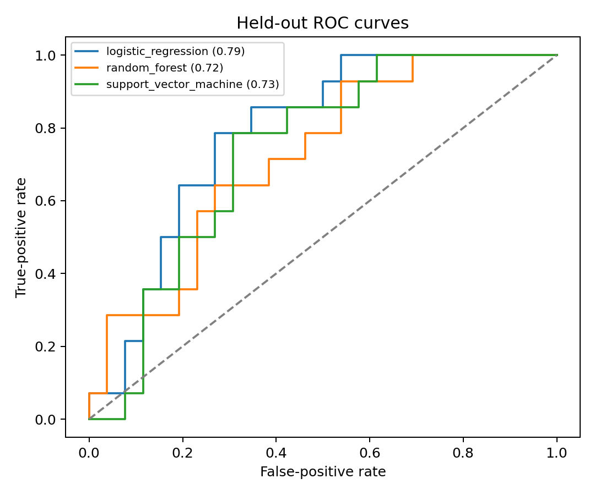
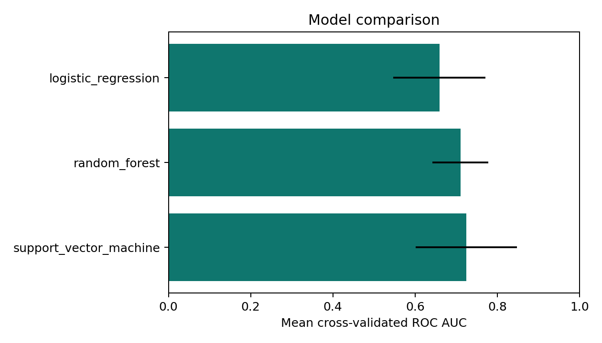

# Predicting immunotherapy response from tumor expression

I built this project to explore a difficult question in cancer bioinformatics: can gene-expression measurements help distinguish patients who respond to immunotherapy from those who do not?

The code implements a full machine-learning workflow and includes a **synthetic demonstration** so it can be explored without patient data. The example figures illustrate the pipeline; they are not evidence of clinical predictive performance.



## How it works

The pipeline joins expression and clinical response tables using sample IDs, checks missing or inconsistent values, and keeps preprocessing within the training folds. It compares logistic regression, random forest, and support vector machines through cross-validation before evaluating on a held-out set.

Outputs include model comparisons, ROC and precision–recall curves, gene-importance tables, a saved fitted model, and a report.



## Running the code

```bash
git clone https://github.com/palrabheru/immunotherapy-response-prediction.git
cd immunotherapy-response-prediction
python -m venv .venv
# Activate .venv for your operating system
python -m pip install -r requirements.txt
python analyze.py --demo --output-dir results/demo
python -m pytest -q
```

See [the analysis notebook](notebooks/01_complete_analysis.ipynb), [source modules](src/), and [example reports and figures](examples/synthetic_demo/) for details. For a real cohort, `python analyze.py --help` lists the expression, clinical, label, and output arguments.

Response definitions matter: complete response, partial response, and stable disease are not interchangeable across studies. Any real-cohort application would require a clearly defined endpoint, patient-aware splitting, and independent validation.

**Author:** [Pal Rabheru](https://github.com/palrabheru)
